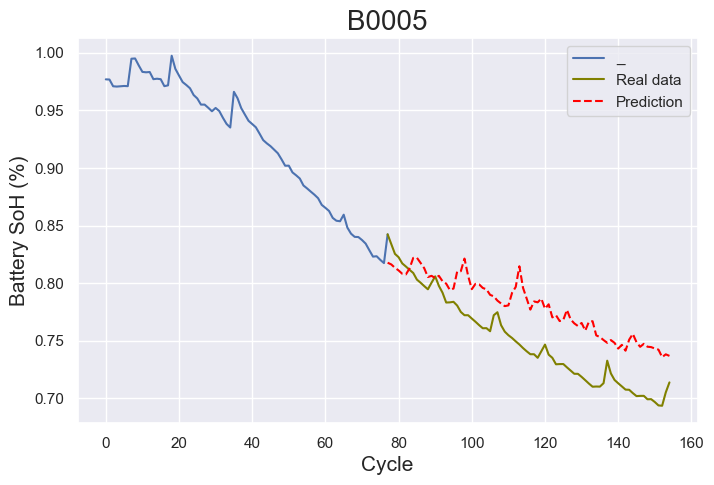
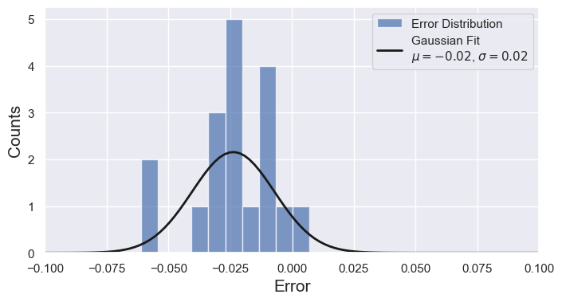
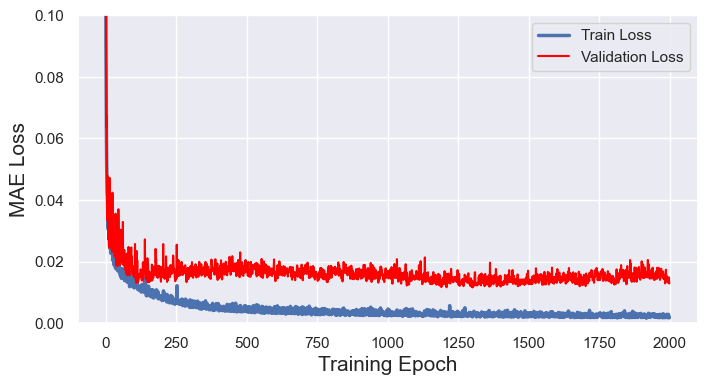

# Battery State-of-Health Estimation with NARX-Transformer

Reproduction and comparative study of the **NARX-Transformer** model for long-term Li-ion battery State-of-Health (SoH) estimation on the NASA battery aging dataset, carried out for the *Machine Learning for Electrical Engineers* course (ITU, 2026).

The model architecture follows Ardakani et al. (IEEE TIM, 2024; see [Citation](#citation)). This repository adds:

- Training and evaluation on the NASA dataset, with **Turkish-annotated** code (`model.py`, `dataset.py`, `main.py`, notebooks)
- A **GRU-CNN baseline** for comparison
- An **input-window study** (3 / 5 / 7 past cycles)


## How the model works

| Part | What it does |
|---|---|
| Conv2D embedding | Compresses the raw voltage / current / temperature curves of each charge cycle into feature vectors |
| Transformer encoder | Self-attention across the last *N* cycles |
| Transformer decoder (NARX) | Uses the **past capacity values** as an exogenous feedback input and attends to the encoded cycles |
| Autoregressive rollout | `pred_sequence()` feeds each prediction back to forecast several cycles ahead |

~142k parameters · PyTorch

## Results

| Model | Avg. RMSE | Avg. MAE |
|---|---|---|
| **NARX-Transformer** | **0.033** | **0.028** |
| GRU-CNN baseline | 0.061 | 0.037 |

*SoH is expressed as a fraction (0–1). Values are taken from `results_NARX_Transformer.ipynb` and `train_GRU_CNN.ipynb`.*

**Input-window study** (best validation loss, `error_comp.ipynb`):

| Past cycles | 3 | 5 | 7 |
|---|---|---|---|
| Validation loss | 0.0213 | 0.0119 | **0.0116** |

Adding more past cycles helps, with diminishing returns beyond 5.

**Long-term SoH prediction: battery B0005**


**Prediction error distribution**


**Training curve**


## Repository structure

```
model.py                       NARX-Transformer model
dataset.py                     NASA data loading, windowing, train/test split
main.py                        Training script
config.yaml                    Hyperparameters (window size, dims, epochs, lr)
train_NARX_Transformer.ipynb   Training + per-battery plots
results_NARX_Transformer.ipynb Evaluation metrics
train_GRU_CNN.ipynb            Baseline model
error_comp.ipynb               Input-window comparison
trained_model.pt               Trained weights
```

## Run

```bash
pip install -r requirements.txt
# Put the NASA battery data CSVs under ./NASA_DATA
python main.py
```

> Note: `results_NARX_Transformer.ipynb` loads the model from a local absolute path; change `model_path` to `trained_model.pt` before running.

## Citation

Original NARX-Transformer model:

```bibtex
@ARTICLE{10680610,
  author={Ardakani, Amirhossein Heydarian and Abdollahian, Seyed Ali and Abdollahi, Farzaneh},
  journal={IEEE Transactions on Instrumentation and Measurement},
  title={NARX Transformer: A Dynamic Model for Leveraging Multicycle Data in Long-Term Battery State of Health Estimation},
  year={2024},
  volume={73},
  pages={1-8},
}
```

Licensed under Apache 2.0 (see `LICENSE`).
